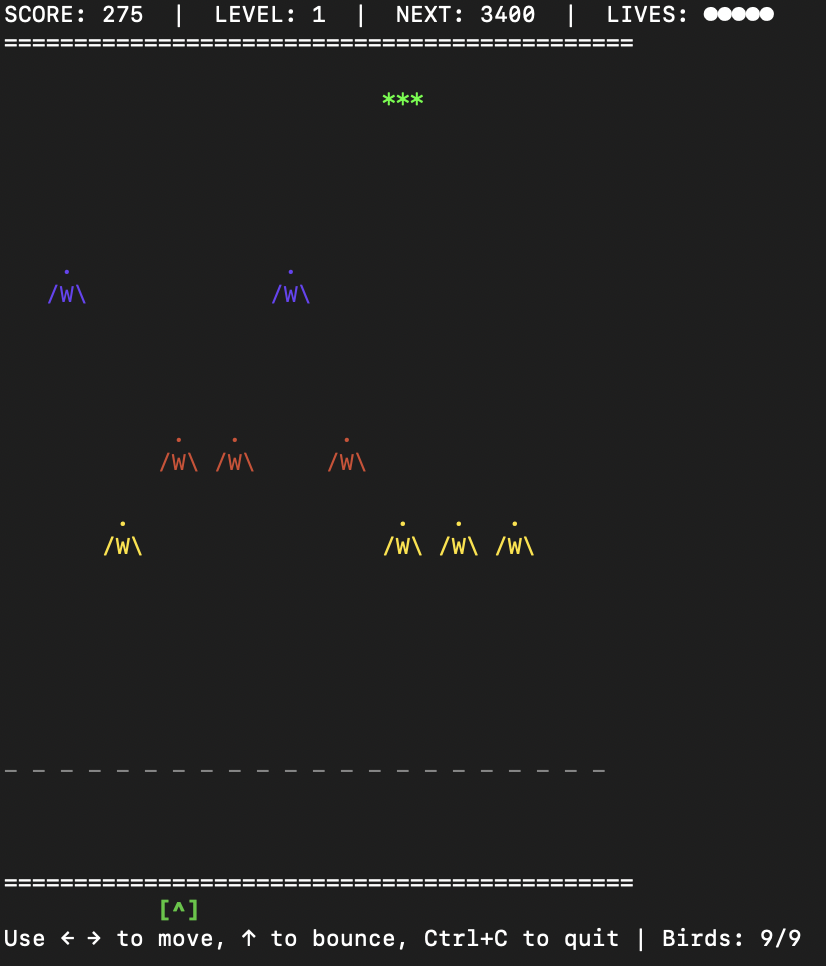
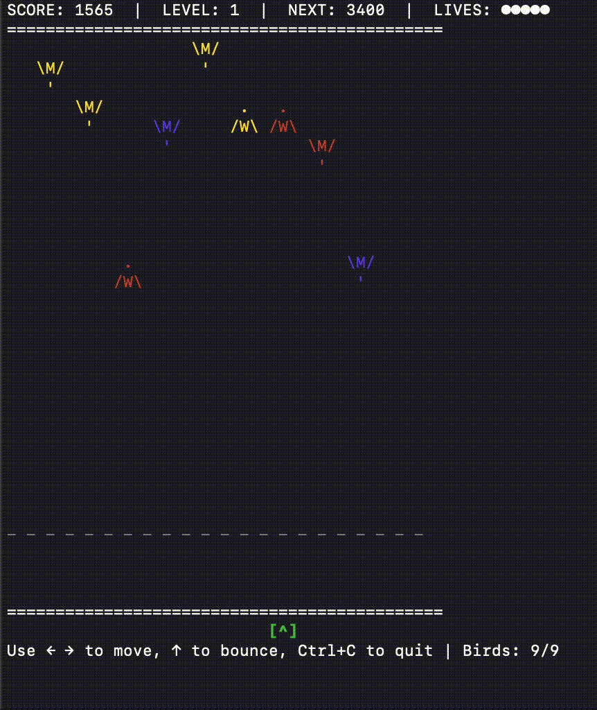

# BVB — Bird vs Bat

[](https://github.com/Onheiron/PY-birds-vs-bats/actions/workflows/ci.yml)

A terminal arcade roguelike: keep a flock of nine birds in the air, use each
bird's power, and fight your way through six biomes of obstacles, bats and
bosses. Pure Python, runs in any modern terminal.





## Quick start

Requires Python 3.10 or newer and a terminal of at least 115 × 38 characters
(the playfield is laid out for a wide screen; shrink the font if it does not fit).

```bash
pip install -r requirements.txt
```

```bash
python3 game.py
```

Standalone binaries for Linux, macOS and Windows are attached to each
[release](https://github.com/Onheiron/PY-birds-vs-bats/releases): unpack and run `BVB`.

`requirements.txt` includes `numpy` and `pygame-ce`: sound effects and the
music, played with real instrument samples and following the flock and the
gear (`docs/music.md`; SDL audio: macOS, Linux, Windows), and the window
mode. Without them the game runs silent and says why.

Optional extras (the game runs fine without them):

```bash
pip install -r requirements-optional.txt
```

- `firebase-admin` + a service account file: online leaderboard (not active yet:
  the client is never connected, see `docs/unused-mechanics.md`)

### Command line

| Option | Meaning |
|---|---|
| `--config FILE` | YAML configuration, merged over the defaults in `config.yml` |
| `--theme FILE` | Colour theme (default `theme.yml`) |
| `--bot PROFILE` | Watch the bot play (see below) |
| `--version` | Print the version |
| `--help` | Show usage |

Setting `BVB_SYNC_OUTPUT=0` disables synchronized terminal updates, in case a
terminal mishandles them.

## How to play

Birds fall; you bounce them back up. A bird that reaches the floor is lost and
costs a life. The higher the flock flies, the more **momentum** you build:
momentum shifts gears (1–10), and gears make everything faster and the miles
go by quicker. Miles take you through 18 levels in 6 biomes, each biome ending
with a boss.

### Controls

| Key | Action |
|---|---|
| ← / → | Move the cursor between lanes |
| ↑ | Bounce the bird in the selected lane; if it is already rising, use its power (once per ascent) |
| SPACE | Select a lane, then SPACE on another lane to swap the two birds (costs momentum) |
| P / ESC | Pause menu: resume, restart, save, load, Birdpedia, settings, FLOCK (every bird's stats: base, power-ups, total; the flock's stats and the cards taken) |
| X | Toggle the XP overlay |
| Q / Ctrl+C | Quit |

Movement, bounce and swap keys can be rebound in **Settings → Controls**.

### Birds

Every bird has a base speed and a power. New birds hatch from eggs dropped by
enemies (only while a lane is free). Birds earn XP, climb grades from D to S,
and raise your **prestige**, which multiplies score and improves loot.

There are 19 birds: Yellow, Red, Blue, Patchwork, Purple, Clockwork, White,
Orange, Gold, Cookie, Stealth, Dinosaur, Glitch, Rainbow, Twister, Frosty,
Poison, Berserk and Rock. `docs/birds.md` describes each one: speed, damage,
power, passive behaviour, prestige and synergies. `docs/stats.md` lists the
stats every bird is made of (speed bonuses, damage, fear resistance, power
uses, luck...) and how kinds and grades change them.

The in-game **Birdpedia** fills in as you discover birds, bats and obstacles.

### Biomes and bosses

| Levels | Biome | Boss (last level of the biome) |
|---|---|---|
| 1-1 … 1-3 | Windy Woods | Giant bat: screams and scatters the flock |
| 2-1 … 2-3 | The Borders | Wind Boss: pushes rising birds down |
| 3-1 … 3-3 | Rotten Marshes | Jelly Boss: keeps spawning bats |
| 4-1 … 4-3 | The Dark Swamp | Tree Boss: branches bloom status-effect flowers |
| 5-1 … 5-3 | The Void Cave | Owl Boss: casts spells and meteor showers |
| 6-1 … 6-3 | Mountain Range | Giant bat (a dedicated boss is still to come) |

Distance does not advance while a boss is alive.

### Enemies and loot

- **Obstacles** scroll down in four tiers; tier 3+ obstacles can hide mini bats
  and jumpscare bats, swamp obstacles grow flowers, cave portals teleport birds.
- **Bats** come in **waves** from the second biome: a card in the right panel
  counts down to the next wave and says how many bats it has and their tier;
  then they come in from the top a few at a time, and the next wave starts
  once all of them are dead. Each bat comes in above a spot it chose (by
  its kind: the strongest bird, birds with powers, full or empty lanes...),
  goes down to a row that depends on its tier, holds, moves a few lanes,
  and after a few spots flies out from the top, coming back a moment later
  with the HP it has left. Mini bats and
  jumpscares still come out of the obstacles at random.
- **Flock bonus:** the score is ×2 with all nine birds alive (full house),
  ×1 with seven or eight, ×0.5 with fewer; the start line shows it by its
  colour: light green, white, light red.
- Bats come in tiers with special kinds: armored, divers, spellcasters.
  From the second biome some are **elites** (gold, marked ♦): tougher, with
  one or two affixes (Swift, Regenerating, Terrifying...) and better drops.
  Enemy stats and affixes are listed in `docs/stats.md`.
- **Eggs** fall from every defeated enemy, coloured by rarity (grey, green, blue,
  purple, yellow, white). Picking one up stops the game and offers three cards
  (more with the right cards; ↑/↓ to choose, ENTER to take): permanent flock bonuses, short boosts,
  power-ups, cursed cards with a drawback, or a new bird while a lane is free.
  An egg has at least one card of its rarity and the others are close to it.
  Three rerolls (R) and three skips (S) per run; cards can also raise luck
  (rarer drops) and prestige.
- **Pacts:** after every boss you may accept one of its pacts, a permanent
  bonus with a permanent drawback, stronger for later bosses, or refuse.
  `docs/cards.md` lists every card and pact.

### Difficulty

Choose it on the title screen with ← / → on **NEW GAME**:

| Difficulty | Preset | Rules |
|---|---|---|
| PEACEFUL | `config_easy.yml` | Fewer, weaker enemies |
| ADVENTURE | `config.yml` | The default balance |
| SURVIVAL | `config_hard.yml` | Hatching a bird no longer gives a life back |
| LEGENDARY | `config_hell.yml` | Brutal enemies, no life recovery, better rare loot |

`hardmode.yml` is a ready-made tougher ruleset to start from:

```bash
python3 game.py --config hardmode.yml
```

### Saves

Progress is autosaved every minute and can be saved to three manual slots from
the pause menu. Saves, settings and Birdpedia discoveries live in `~/.bvb/`.

## Configuration

`config.yml` is the complete, commented reference of every tunable: layout,
birds, enemies, bosses, loot tables, progression, controls. A custom file only
needs the values it changes:

```yaml
# my_config.yml
bat_enemy:
  max_on_screen: 3
birds:
  default_formation: [YELLOW, YELLOW, RED, RED, RED, BLUE, BLUE, PURPLE, CLOCKWORK]
```

```bash
python3 game.py --config my_config.yml
```

`config.sample.yml` is a starting point. Configurations are validated at
startup against `config.schema.json`: a misspelt section or a value of the
wrong type stops the game with a message naming the offending key. Colours
come from `theme.yml`; `theme_accessible.yml` is the high-contrast palette
enabled from **Settings → Graphics → Accessibility**.

## Development

```bash
pip install -r requirements-dev.txt
```

| Task | Command |
|---|---|
| Run the tests | `python3 -m pytest` |
| Lint | `ruff check .` |
| Format | `ruff format .` |
| Regenerate the config schema after adding keys to `config.yml` | `python3 tools/gen_config_schema.py` |
| Measure frame time | `python3 tools/benchmark.py` (add `--profile` for hot spots) |
| List configuration keys the game never reads | `python3 tools/config_usage.py` |
| Build a standalone binary | `pyinstaller --noconfirm packaging/BVB.spec` |

### Project layout

```
game.py                 entry point
config*.yml, theme*.yml  balance, difficulty presets, colours
src/core/               config loading, constants, mutable game state
src/entities/           bird types and sprites
src/engine/             loop, systems, clock, events, input, menus, physics, powers
src/engine/logic/       collisions, spawning, loot, effects, portals, scoring
src/engine/logic/bosses/  one module per boss + the director that picks them
src/ui/                 framebuffer, terminal, keyboard, colours, screens
src/ui/layers/          one module per render layer, drawn back to front
src/services/           saves, achievements, sound, leaderboard
src/sim/                bot, headless runner and run statistics
tests/                  unit tests + a headless replay harness
tools/                  simulator, schema generator, benchmark, binary smoke test
packaging/              PyInstaller spec
```

### How it runs

- The loop renders at a fixed 60 FPS, so input is always responsive; physics
  and game logic advance every 2–10 frames depending on the gear.
- Rendering goes through a double-buffered framebuffer: layers draw cells, and
  only the cells that changed since the previous frame are sent to the
  terminal (typically a few hundred bytes per frame).
- Every simulation tick runs the systems listed in `src/engine/systems.py`, in
  phase order: move, progress, collide, spawn, act, effects, cleanup.
- Game code announces what happens (`bat_killed`, `loot_dropped`, `bird_lost`...)
  through `src/engine/events.py`; achievements, sounds and the simulator's
  statistics subscribe to those events instead of being called directly.
- Timed effects read the game clock (`src/engine/clock.py`), which stops while
  the game is paused and is stored in saves.
- Every number about a bird (damage, fear, power uses, score...) is a stat from
  `src/engine/stats.py`: defaults, values per kind and per grade from the
  `bird_stats` config section, plus timed or permanent modifiers.
- Bird powers are looked up by bird type (`POWERS` in `src/engine/powers.py`);
  shared traits such as Stealth phasing live in `src/engine/bird_kinds.py`.
- Menus are one declarative tree (`src/engine/menus.py`) shared by the title
  screen and the pause menu; `src/ui/layers/menus.py` draws any of its screens.
- All state lives in `src/core/state.py`, all tunables in `src/core/constants.py`
  (loaded from the config). A game is deterministic for a given seed, which is
  what the test harness (`tests/harness.py`) relies on: it runs the real loop
  with a virtual clock and a tiny terminal emulator instead of a screen.

### Window mode and Steam

```bash
python3 game.py --window
```

```bash
python3 game.py --fullscreen
```

The game in a window of its own: keyboard and
gamepad (A bounces, B swaps, Start pauses...). This is the Steam build: see
`docs/steam.md` for the controller layout, the Linux depot built in the Steam
Linux Runtime and how to upload it.

### Watching the bot

```bash
python3 game.py --bot expert
```

```bash
python3 game.py --bot perfect --speed 4 --start-level 10 --difficulty legendary
```

Options: `--bot` (`perfect`, `expert`, `average`, `novice`, `me`), `--bot-set
key_interval=3` to tweak it, `--seed`, `--difficulty`, `--start-level`,
`--formation RED,RED,...`, `--set section.key=value`, `--speed`, `--games N`
(back to back, one seed after the other), `--sound`. While it plays: `+`/`-`
change speed (x0.25 to x16), `B` takes over the controls and gives them back,
`P` opens the pause menu, `Q` quits. A watched game is the same game the
simulator plays for that seed and those options.

### A bot that plays like you

The `me` bot plays like the person whose games it was fitted from: same key
rate, same habits (how high birds are bounced, UPs pressed out of habit,
swaps to brake, the gear kept), same liking for cards and pacts. It comes
fitted from the author's games; fit it to yours from your recordings:

```bash
python3 tools/fit_bot.py
```

```bash
python3 tools/fit_bot.py --calibrate
```

The first measures every recording in `~/.bvb/recordings/` (replayed with the
code it was played with, from its commit) and writes `~/.bvb/bot_profile.json`;
`--calibrate` also plays the bot on your seeds and tunes it until its games
look like yours (a few minutes). Then test a change without playing:

```bash
python3 tools/simulate.py --bot me --runs 20
```

```bash
python3 game.py --bot me
```

More recordings make a better fit: run it again after a few games.

### Recording and replaying your games

Every game started with NEW GAME is recorded when it ends, in
`~/.bvb/recordings/` (seed, difficulty, configuration, settings, upgrades,
the time of every frame and every key). Replaying one runs the very same game
again, headless, and compares it with the bot on the same seed:

```bash
python3 tools/replay.py --list
python3 tools/replay.py --bot expert --bot average
```

The report shows keys per second (moves and UP apart), the time between a
move and the next UP, how far birds had fallen when bounced, swaps, powers
and how birds were lost. Games continued with CONTINUE are recorded too: the
recording keeps the loaded game and its replay starts from there. A
recording also keeps the git commit of the code it was played with: a replay
matches only with that same code, and `replay.py` says which commit to check
out when it differs.

### Balance simulator

Bot strategies (braking with swaps, formations, fewer birds, favourite
birds, adaptive card choices) are described and compared in
`docs/strategies.md`: `python3 tools/simulate.py --strategies default,brake,yellow_guard`.
`tools/analyze.py` ranks what matters most (every factor drawn at random per
game) and which card or pact is worth taking in which situation; see
`docs/analysis.md`.

`tools/simulate.py` plays whole games headless with a bot and reports the
numbers that matter for tuning: how far runs get, why birds are lost, gears
and prestige, loot by source and rarity, eggs hatched, bosses beaten. A full
game takes about ten seconds of CPU, and runs are spread over all cores.

```bash
python3 tools/simulate.py --runs 40
```

```bash
python3 tools/simulate.py --runs 60 --bot perfect --variant "base:" --variant "slower: speed.mph_per_level=30"
```

- `--bot` picks a player: `perfect` (60 keys/s, instant), `expert` (7.5 keys/s,
  200 ms reactions), `average` (5 keys/s), `novice` (3 keys/s); `--bot-set key_interval=3` adjusts one trait.
- `--set section.key=value` changes the configuration, `--variant` compares
  several configurations on the same seeds, `--base FILE` starts from another
  config, `--difficulty`, `--start-level`, `--formation RED,RED,...` set up the game.
- `--json FILE` saves every run summary for your own analysis.

The bot plays through the same input path as a person: it moves the cursor and
presses UP, at most once per `key_interval` frames. It prioritises the bird
closest to being lost, bounces birds before they fall past an enemy (birds only
collide while rising), fires powers when they help and waits under the next
bird to fall. Its randomness is separate from the game's, so a seed always
replays the same game.

### Removed mechanics

`docs/unused-mechanics.md` records the mechanics, achievements, art and
configuration keys removed because nothing in the game used them, and the
configuration the game ignores by mistake (still to be fixed).

### Adding a boss

1. Write `src/engine/logic/bosses/<name>.py` with a `spawn_<name>_boss()` and an `update_<name>_boss()`.
2. Register it in `SPECIAL_BOSSES` in `src/engine/logic/bosses/director.py` with its config section and level.
3. Add a renderer to `_BOSS_RENDERERS` in `src/ui/layers/bosses.py`.
4. Add its section to `config.yml` and run `python3 tools/gen_config_schema.py`.

### Releasing

1. Bump `__version__` in `src/__init__.py`.
2. Tag the commit `vX.Y.Z` (it must match `__version__`) and push the tag.

The Release workflow runs the tests, builds binaries for Linux, macOS and
Windows, smoke-tests each one and publishes them as a GitHub release.

## Terminal notes

- A terminal with 256 colours and UTF-8 is required; truecolor is used when `COLORTERM` advertises it.
- Stealth birds use the ANSI "conceal" attribute; terminals that ignore it simply show the bird.
- On Windows use Windows Terminal (the legacy console lacks the needed character set).
